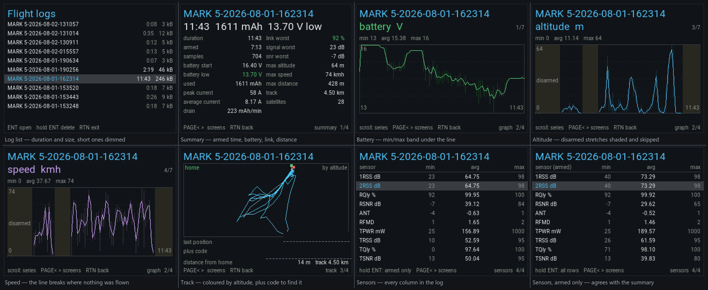

# EdgeTX Flight Log

A Lua tool for **EdgeTX** radios that reads the CSV logs the radio already
writes to `/LOGS` and shows you the flight: how long, what the battery did,
where the link struggled, how high and how far, and where the model ended up.

No computer, no Companion, no card reader. It reads the log on the radio,
right after you land.

## It does not know what protocol you fly

There is no CRSF code in it, and no GHST code either. The log header names every
column and its unit, because EdgeTX writes `label(unit),` for each enabled
sensor. So the columns are matched to *roles* by name:

| role | CRSF / ELRS | GHST | FrSky |
| --- | --- | --- | --- |
| link quality | `RQly`, `TQly` | `RQly` | – |
| signal | `1RSS`, `2RSS`, `TRSS` | `RSSI` | `RSSI` |
| noise | `RSNR`, `TSNR` | `RSNR` | – |
| pack voltage | `RxBt` | `RxBt` | `VFAS`, `A1`, `A2` |
| current | `Curr` | `Curr` | `Curr` |
| used capacity | `Capa` | `Capa` | `Fuel` |
| altitude | `Alt`, `GAlt` | `GAlt` | `Alt`, `GAlt` |
| speed | `GSpd`, `ASpd` | `GSpd` | `GSpd` |
| satellites, position | `Sats`, `GPS` | `Sats`, `GPS` | `Sats`, `GPS` |

Anything unrecognised is not thrown away — it turns up on the sensor page with
its own min, average and max. A protocol nobody has thought of yet still works,
as long as its sensors are named sensibly.

## Screens

**PAGE<** and **PAGE>** move between screens, the scroll wheel moves around
inside one. On a radio without page keys, **ENT** steps through them.

### Log list

Every log with its **duration and size**, newest first. Anything shorter than a
minute is dimmed, so the flights stand out from the false starts.

The duration does not come from reading the file. `fstat` gives the size and
`io.seek` is absolute, so two short reads at the two ends of the log find the
first and last timestamps. Only the rows on screen are measured, a couple per
frame, so a card full of logs still scrolls.

Hold **ENT** on a log to delete it. "Delete all" is on the same screen but needs
a *held* ENT, so a stray press cannot empty the folder.

### Summary

Duration, how much of it was armed, battery start and low, mAh used and mAh per
minute, peak and average current, worst link and signal, link dropouts, maximum
altitude and speed, furthest distance and total track.

### Graphs

One series filling the screen, drawn as a line through the average of each
bucket with a dim min/max band behind it, so a single sample dip is still
visible after downsampling. Scroll to change series.

### Track

The GPS path scaled to fit, aspect corrected for latitude so the shape is not
stretched, and coloured along its length by altitude. Green is home, red is the
last position reported — with its coordinates and a **plus code** you can paste
straight into Google Maps, which is the part you want when it is in a field
somewhere and you are not.

### Sensors

Every numeric column in the log with min, average and max, named the way the
header named it, including the ones this tool has no idea about. Sticks,
switches and the 32 channel outputs are left out, because they are not sensors.

**Hold ENT** to switch between every row and armed rows only, so this page can
be made to agree with the summary instead of quietly disagreeing with it — the
whole log says `Alt` peaked at 163 m, the armed rows say 64 m, and both are
true statements about different things.

## Two things it corrects for you

**Betaflight altitude.** While armed, BF reports height above the arming point.
While **disarmed it reports height above sea level**, so a quad sitting on the
ground claims to be at the elevation of your field. BF marks disarmed with a
trailing `*` on the flight mode, so altitude and speed are counted only from
armed rows. On one of my logs that changed "max altitude" from 163 m — the quad
on the ground — to the 64 m it actually flew.

**Numbers that have precision keep it.** Two decimals where the reading
carries them, none where it does not, so an altitude logged in whole metres
reads 64 rather than 64.00 and a current of 58.9 A is not rounded to 59.

**Startup rubbish.** A log begins before telemetry is live, so the first rows
carry placeholder readings: a battery that reads 8.9 V on a 4S that never went
below 13.7, and GPS coordinates in the middle of the Atlantic. Voltages below a
plausible fraction of the pack maximum are ignored, and a fix is only trusted
once there are at least four satellites.

## Install

1. Download the zip from the [latest release](https://github.com/juricabi/edgetx-flight-log/releases/latest)
   and extract it to the root of the SD card, or copy `flightlog.lua` to
   `SCRIPTS/TOOLS/` yourself.
2. On the radio: **SYS → Tools → Flight log**.

Logging has to be switched on for the sensors you care about — a sensor with its
`logs` flag off simply is not in the file, and the tool will not invent it.

## Memory and long logs

The file is never loaded whole. It is read in blocks and reduced as it goes:
a fixed number of buckets per series, halved and re-spanned when they fill, and
a GPS track thinned the same way. A 20 MB log costs the same as a 200 KB one.

Bear in mind EdgeTX's Lua has no line reading at all — `io.read(file, n)` takes
a **byte count**, and file handles have no methods — so the lines are cut out of
the blocks by hand.

## Radio compatibility

The layout adapts to the screen: black and white radios (128x64, 212x64), the
small colour set (320x240), the standard set (480x272, 480x320) and the large
set (800x480). Small screens drop the page tag, shorten the labels and stop
adding rows when they reach the footer.

It has only been **tested on a HelloRadioSky V12** (320x240) with GHST
telemetry. Elsewhere expect it to work, but please report anything that looks
wrong.

## Related

- [EdgeTX BT AT Terminal](https://github.com/juricabi/edgetx-bt-at-terminal) —
  configure a Bluetooth serial module from the radio
- [Telemetry mirror is unusable with a Ghost module](https://github.com/EdgeTX/edgetx/issues/7609)
- [Radio locks up when a Lua script sends MSP over Ghost](https://github.com/EdgeTX/edgetx/issues/7607)

## Support

If you like it, you can buy me a coffee:

## License

MIT
